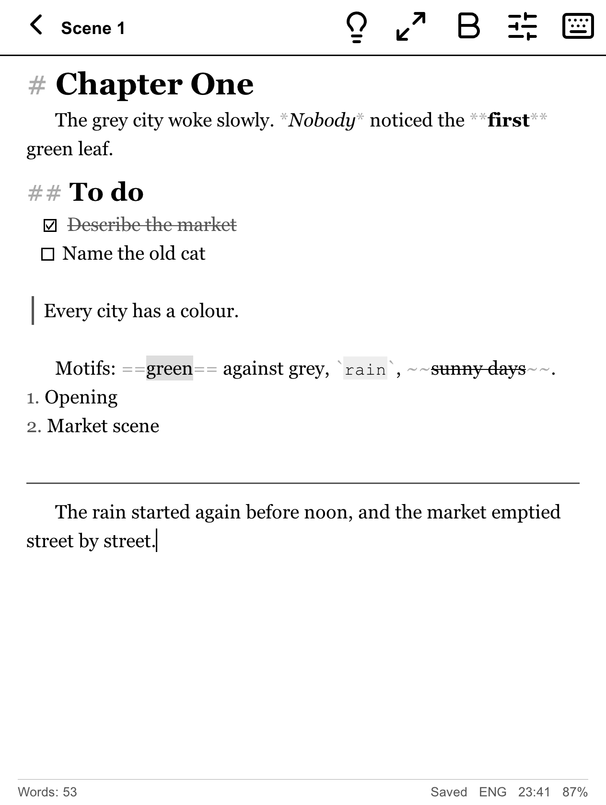
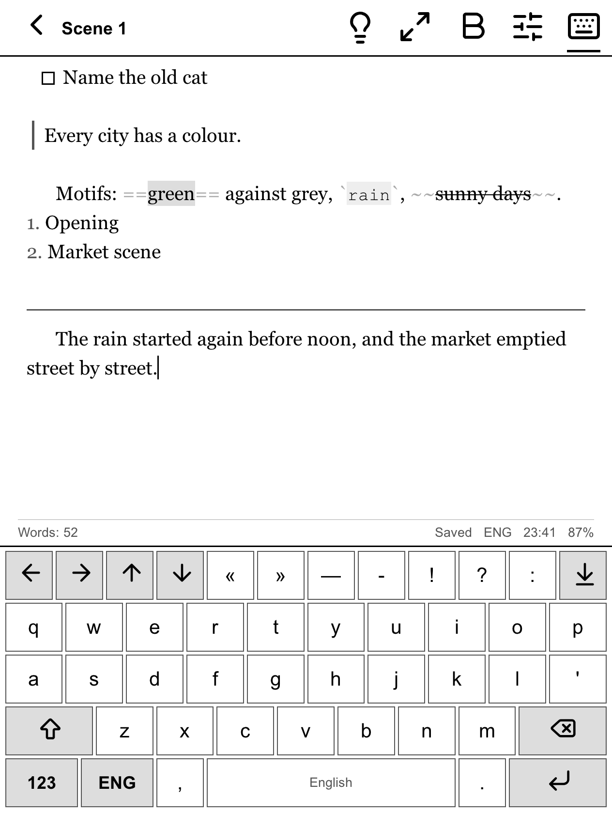
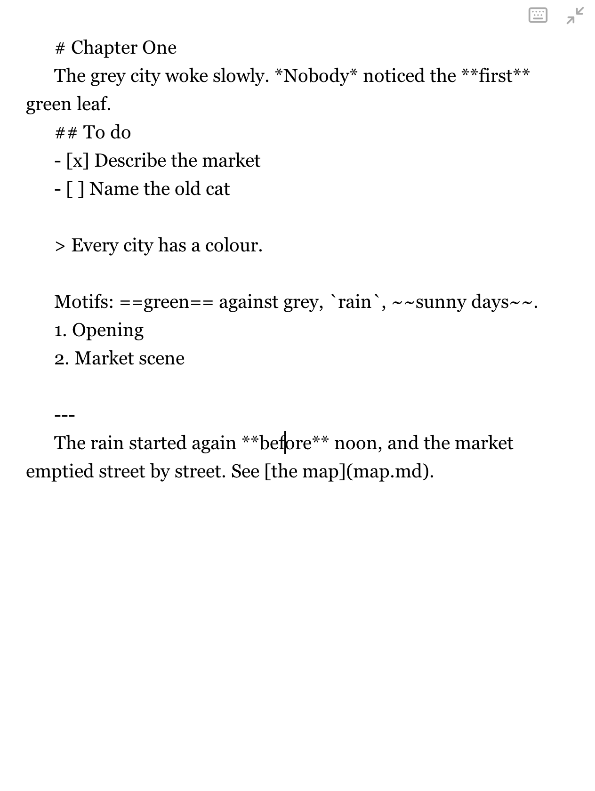
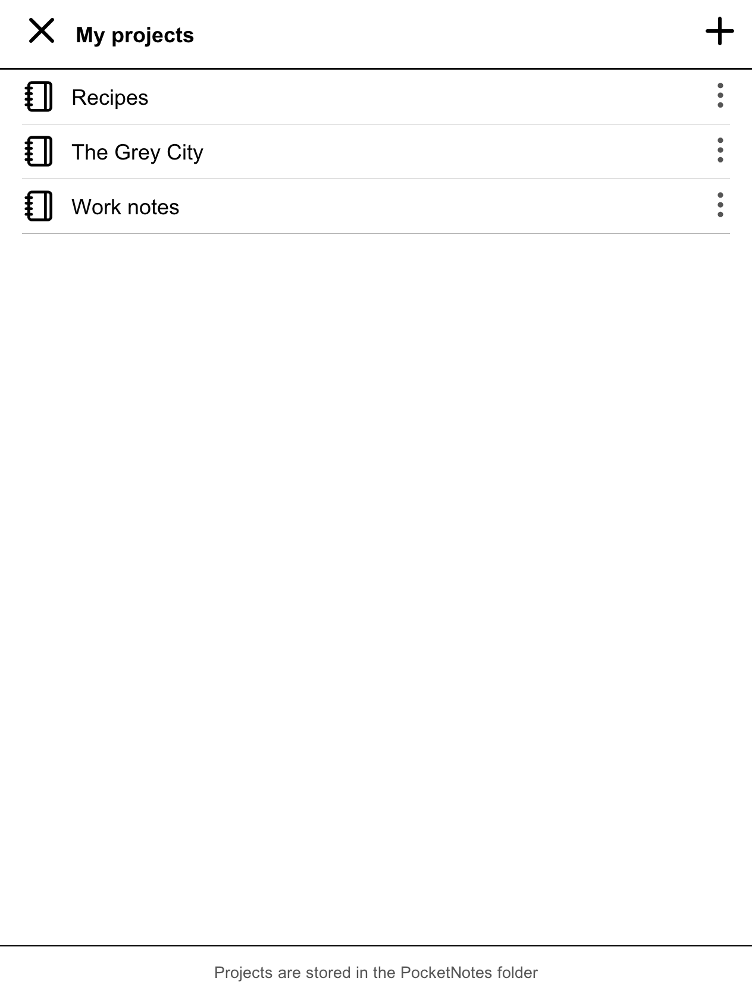
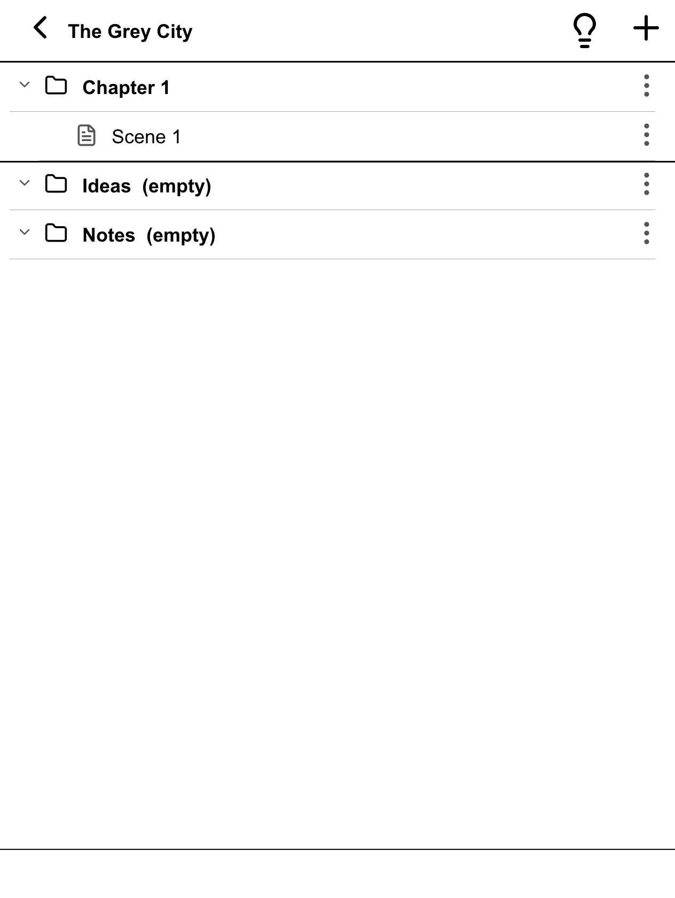
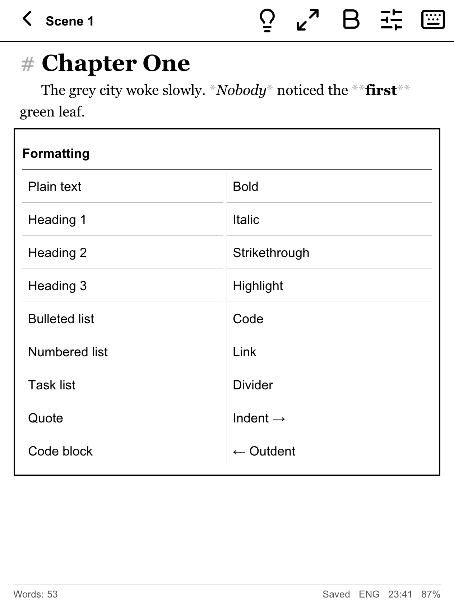
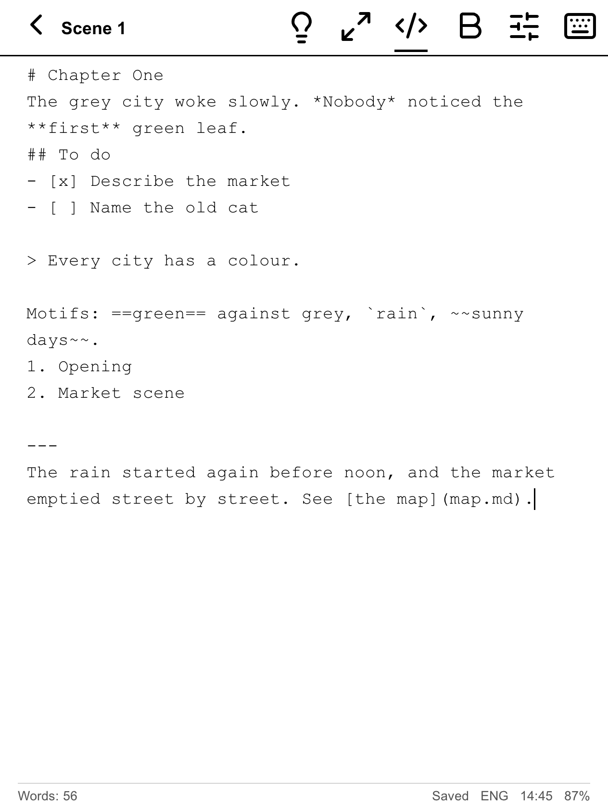
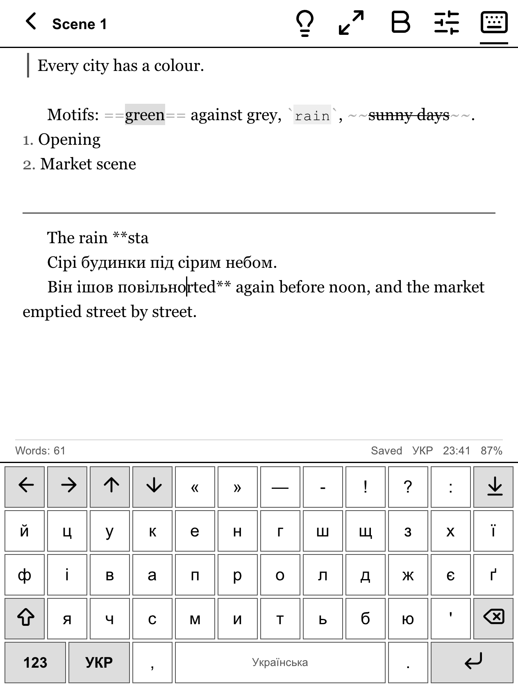

# PocketNotes

A distraction-free Markdown notebook for PocketBook e-readers. It is built for the
PocketBook Era Color and should work on other PocketBook devices with firmware 6.x.

Keep journals, work notes, recipes, research, or a novel in progress. Notes are plain Markdown
files in ordinary folders, so you can open them on any computer.

<p>
  
  
  
</p>
<p>
  
  
  
</p>
<p>
  
</p>

## Features

- **Projects:** each project is a folder of notes and sub-folders. Start one empty, or from the
  *Book* template (chapters, scenes, ideas and notes).
- **Markdown on e-ink:**
  - headings, **bold**, *italic*, ~~strikethrough~~, ==highlight==, `inline code`;
  - code blocks, quotes (nested too), dividers;
  - bulleted, numbered and nested lists, plus task lists you tick with a tap;
  - links, images (shown as their caption), tables (columns aligned).

- **Two views:** *Formatted* is the default. The note looks like a word-processor page and shows
  no Markdown symbols. Typing works like Word: bold and other styles carry on across spaces,
  `---` makes a divider, `` ``` `` makes a code block, and Backspace at the start of a heading or list
  item removes that formatting. *Source* shows the file exactly as saved, in a fixed-width font.
  The `</>` button switches between them, and the app remembers your choice.
- **Colour:** in Formatted view, highlights are yellow, links and quote bars are blue, ticks on
  done tasks are green, and code has a pale blue tint. On black-and-white PocketBooks these show
  as greys.
- **Formatting menu:** applies any of the above to the current line or word. With no word
  selected, choosing a style turns it on for what you type next. Enter continues a list, and
  Enter on an empty item ends it.
- **Zen mode:** just your text, with no toolbars and no formatting (plain text, as in Source view). One tap in and one tap out.
- **Quick notes:** the 💡 button saves a thought straight into the project's `Ideas` folder.
- **On-screen keyboard** built for e-ink:
  - several keyboard languages (choose yours in Settings), plus symbols;
  - capitals at the start of sentences;
  - cursor keys, and Backspace that repeats while held.
- **Physical keyboards:** supported when the device firmware passes key presses to apps (see
  *Limitations*).
- **Safe by design:**
  - saves 4 seconds after you stop typing, and whenever you leave a note or the device sleeps;
  - every save writes a temporary file first, then replaces the note in one step;
  - the 20 most recent versions of each note are kept in `.history`;
  - deleted items go to `.trash`.
- **Picks up where you left off:** reopens the last note at the cursor.
- **E-ink friendly:** only changed lines are redrawn while you type, and a clean refresh follows
  when you pause.
- **Interface languages:** English (default) and Ukrainian.

## Installing

1. Build `PocketNotes.app` (see *Building*) or take it from a release.
2. Connect the PocketBook over USB and choose *PC link* on the device.
3. Copy `PocketNotes.app` into the `applications` folder on the device.
4. Eject the device, then open **Applications → PocketNotes**.

## How notes are stored

Everything lives in the `PocketNotes` folder at the root of the device storage:

```
PocketNotes/
  The Grey City/                a project is a folder
    01 Chapter 1/               folders can be nested
      01 Scene 1.md             notes are Markdown files
      02 Scene 2.md
    Ideas/                      quick notes (the 💡 button), one file each
    Notes/
    .history/                   earlier versions of each note
    .trash/                     deleted items (move them back to restore)
  Work notes/
    01 Meeting.md
```

- The number prefix ("01 ") sets the order. Moving items up or down renumbers them.
- Folders named `Ideas`/`Ідеї` and `Notes`/`Нотатки` sort to the bottom and keep plain names.
- Notes are UTF-8 Markdown, so they open in any Markdown app (Obsidian, iA Writer, VS Code…).

## Physical keyboard shortcuts

| Keys | Action |
|---|---|
| Ctrl+Space, Alt+Shift, Ctrl+Shift | Switch keyboard language |
| Alt + `-` `,` `.` `/` `'` | — « » … ’ |
| Ctrl+S | Save now |
| Arrows, Home/End, PgUp/PgDn | Move the cursor |
| Esc | Back (or leave Zen mode) |

The PocketBook's page buttons scroll by a page; so does swiping up or down.



## Building

Requirements: macOS or Linux, a C compiler, and Docker for the PocketBook build.

```
make test      # unit tests
make sim       # a simulator that renders the app's screens to PNG files
./build/sim build/shots
make device    # cross-compiles build/device/PocketNotes.app
make install   # copies it to a PocketBook mounted at /Volumes/PB700K3
make icons     # regenerates src/ui/icons_data.* from the Lucide font
```

One-time setup of the PocketBook SDK (6.8, B300 platform) in a Docker volume:

```
docker build -t pocketnotes-build tools/docker
docker volume create pbsdk
curl -LO https://github.com/pocketbook/SDK_6.3.0/releases/download/6.8/SDK-B300-6.8.7z
docker run --rm -v pbsdk:/sdk -v "$PWD:/dl" pocketnotes-build sh -c 'cd /sdk && 7z x /dl/SDK-B300-6.8.7z'
```

`tools/keytest` builds a small diagnostic app that shows which key events reach apps on your device.

## Code layout

- `src/core/`: platform-independent logic, covered by `tests/`. Includes the text document,
  line wrapping, Markdown parsing, project folders, file saving, keyboard layouts and settings.
- `src/ui/`: screens on PocketBook's InkView toolkit: projects, project outline, editor,
  pop-ups and the on-screen keyboard.
- `src/host/`: a stand-in for InkView on the desktop, used by the simulator.

## Limitations

- **Physical keyboards:** stock PocketBook firmware may not pass Bluetooth or USB keyboard input
  to third-party apps. PocketNotes listens for the firmware's extended key events, and reads the
  input devices directly when it is allowed to.
- **Not yet available:** syncing (copy files over USB for now), undo, and copy/paste.

## License

MIT; see [LICENSE](LICENSE). Icons are from [Lucide](https://lucide.dev) (ISC licence). The
simulator uses [stb](https://github.com/nothings/stb) (public domain).
